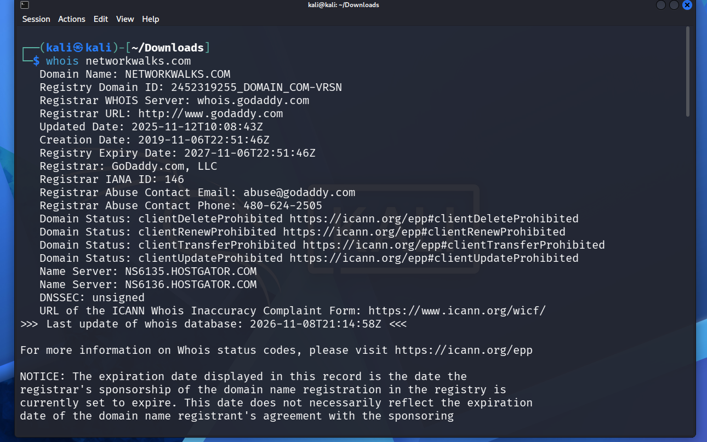

# PENETRATION-TESTING-REPORT
FOOTPRINTING &amp; NETWORK SCANNING PHASES

# Liability Disclaimer
I have performed these activities only on the systems & devices where I had secured written permission or the devices/systems that I own myself. All these materials are for education and research purpose only. Do not use anything from here to break the law. The instructor, the authors and Networkwalks are not responsible for what you do with this knowledge. Every action you take is your own responsibility. Misuse can lead to criminal charges, heavy fines, loss of your job and a permanent record. In most countries unauthorized access is a crime even when nothing is damaged.

# Table of Contents
1.	Executive Summary
2.	Assessment Scope and Authorization
3.	Assessment Methodology and Tools
4.	Phase 1 – External Reconnaissance and Footprinting
5.	Phase 2 – Internal Network Discovery
6.	Consolidated Security Findings
7.	Remediation Recommendations
8.	Assessment Limitations
9.	Conclusion
10.	Assessor Declaration 

# 1. EXECUTIVE SUMMARY
This report documents the results of an authorized cybersecurity assessment conducted as part of the Networkwalks cybersecurity training programme.

The assessment focused on two foundational penetration testing phases:
•	Phase 1: Reconnaissance and Footprinting.
•	Phase 2: Scanning and Network Discovery.
The assessment involved an external reconnaissance exercise against Networkwalks.com and an internal network discovery exercise within a VMware virtual laboratory.
The primary objective was to identify publicly observable website infrastructure, technologies, DNS configuration, security controls and active devices within the authorized internal network.

# 1.1 External Assessment Summary
The external assessment identified the following technologies and infrastructure characteristics:

•	Domain registration through GoDaddy.

•	Hosting infrastructure associated with HostGator.

•	Apache web server identification.

•	WordPress content management system.

•	WordPress Download Manager plugin identification.

•	ModSecurity (SpiderLabs) web application firewall detection.

•	Public IPv4 address: 192.232.216.135.

•	DNSSEC reported as unsigned.

•	SPF record identified.

•	Further verification required for DKIM and DMARC.

•	Additional HTTP security-header improvements recommended.

No confirmed exploitable vulnerabilities were established from the supplied evidence.

# 1.2 Internal Network Assessment Summary
An internal host discovery assessment was conducted against:

Authorized laboratory network

192.168.113.0/24

The assessment used Nmap 7.993 through the Zenmap graphical interface.

The command executed was: nmap -sn 192.168.113.0/24

The scan identified:

| Metric | Result | 
|------|---------|
| Total IPv4 addresses | 256 | 
| Active hosts identified | 7 | 
| Scan duration | 7.93 seconds |
| MAC addresses displayed | 6 |
| Identified VMware MAC vendors | 6 | 

The results provided an initial overview of the virtual laboratory network.

# 1.3 Overall Assessment
The assessment successfully achieved its objectives for reconnaissance, footprinting and initial network discovery.

However, the activities did not include comprehensive service enumeration, authenticated testing, vulnerability verification or exploitation.

Consequently, the findings should be interpreted as preliminary security observations rather than a complete determination of the security posture of the assessed systems.

# 2. ASSESSMENT SCOPE AND AUTHORIZATION

2.1 Assessment Targets

Two environments were included in the assessment.	

| Target | Assessment type  | 
|------|---------|
| [Total IPv4 addresses](https://networkwalks.com ) | External reconnaissance | 
| 192.168.113.0/24 | Internal network discovery | 
| VMware virtual laboratory | Internal testing environment |

# 2.2 Authorization

The assessment was performed on systems for which written authorization had been obtained or within the assessor's own laboratory environment.

| Authorization item | Status | 
|------|---------|
| Client permission | Confirmed by assessor | 
| Local LAN authorization | Assessor-owned environment | 
| Assessment purpose | Educational and security research |
| Exploitation | Not performed | 
| Authenticated testing | Not performed |

# 2.3 Assessment Objectives

The objectives were to:

1.	Identify publicly available domain registration information.
2.	Identify website technologies and infrastructure.
3.	Detect the presence of a web application firewall.
4.	Review publicly observable DNS configuration.
5.	Inspect selected HTTP response headers.
6.	Identify active devices on the authorized internal network.
7.	Examine available MAC address vendor information.
8.	Visualize the discovered network topology.
9.	Document observations and security improvement opportunities.

# 3. ASSESSMENT METHODOLOGY AND TOOLS

The assessment followed a structured reconnaissance and network discovery methodology.

# 3.1 Tools Used	
	
| Tool | Purpose | 
|------|---------|
| WHOIS | Domain registration investigation | 
| WhatWeb | Website technology fingerprinting | 
| WAFW00F | Web application firewall detection |
| NSLookup | DNS resolution | 
| DNSRecon | DNS record enumeration |
| cURL | HTTP response inspection |
| Nmap 7.993 | Network host discovery |
| Zenmap | Graphical network scanning and topology visualization |
| Kali Linux | Security assessment environment |

# 3.2 Assessment Phases

Phase 1 – Reconnaissance and Footprinting

Completed

Public information gathering, domain research, technology identification and DNS inspection.

Phase 2 – Scanning and Network Discovery

Completed

Internal host discovery, MAC address identification and topology visualization.

Phase 3 – Enumeration

In progress

Phase 4 – Vulnerability Assessment

Pending

Phase 5 – Reporting and Remediation Validation

In progress

# 4. PHASE 1 – EXTERNAL RECONNAISSANCE AND FOOTPRINTING

The external assessment focused on collecting publicly observable information about the target domain, website technologies, hosting infrastructure, DNS records and HTTP security configuration.

No exploitation or authenticated penetration testing was performed.

# 4.1 WHOIS Domain Investigation

Tool: WHOIS

Command executed: whois networkwalks.com

# Results

