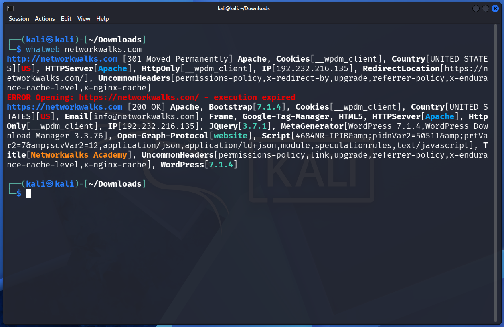
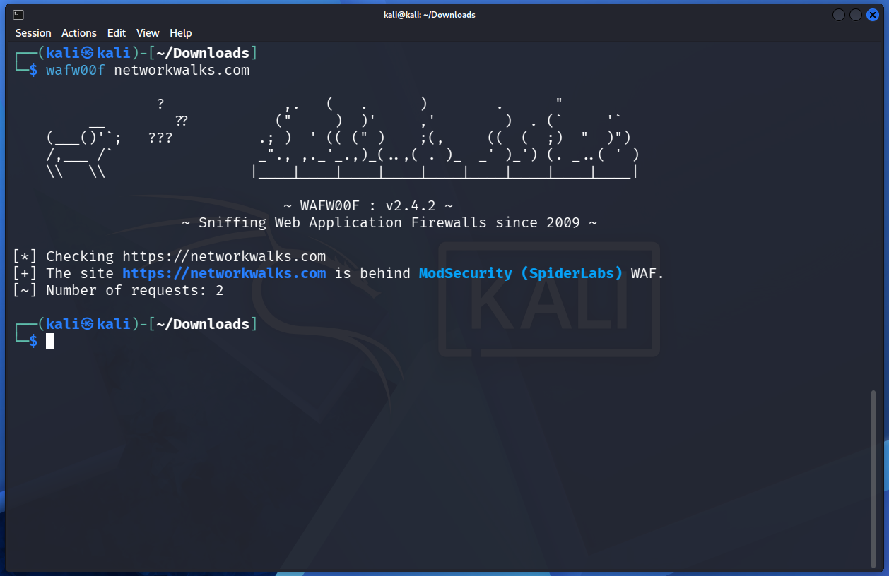
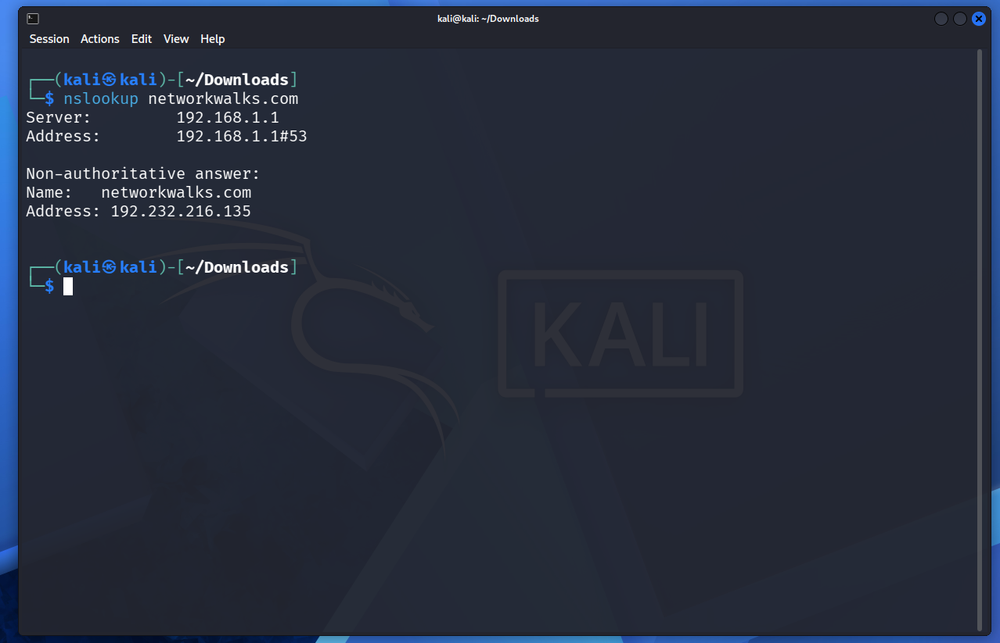
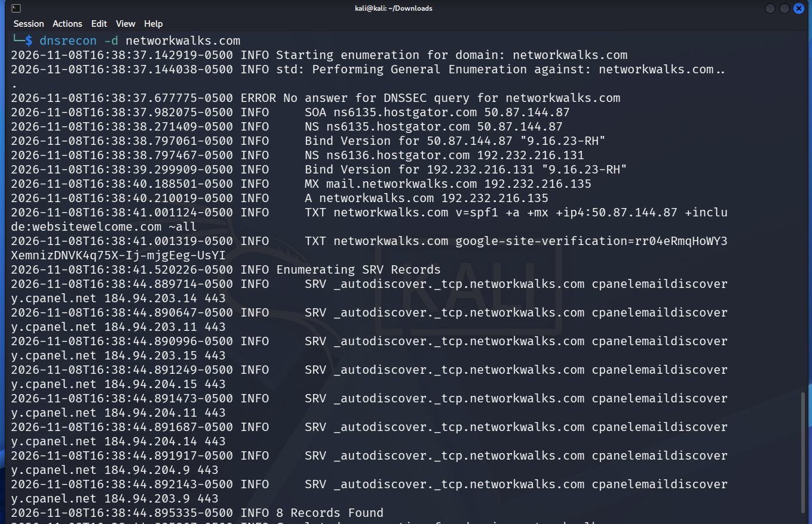
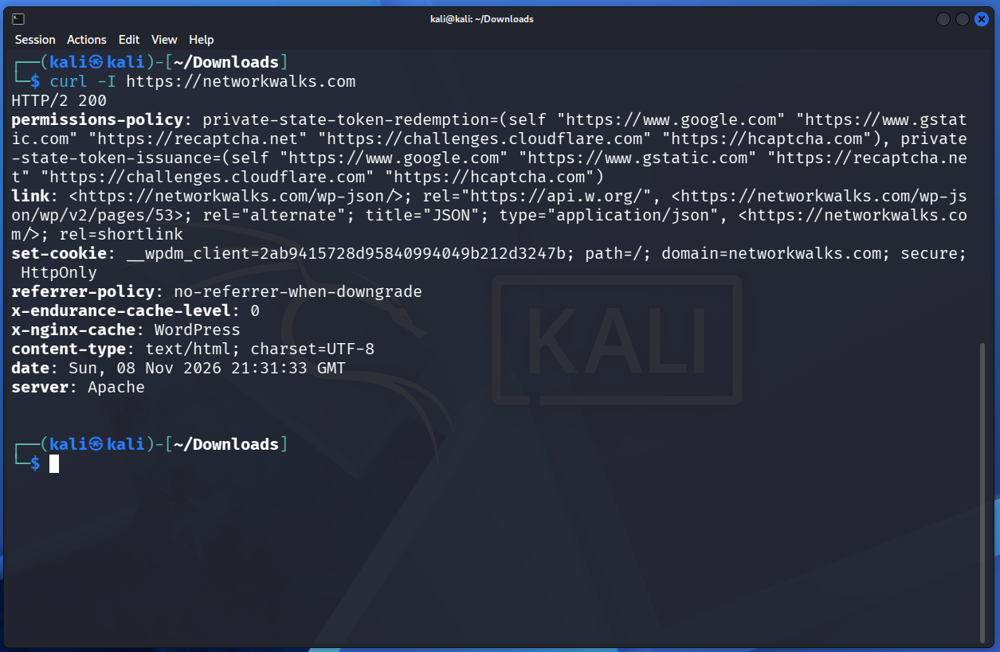
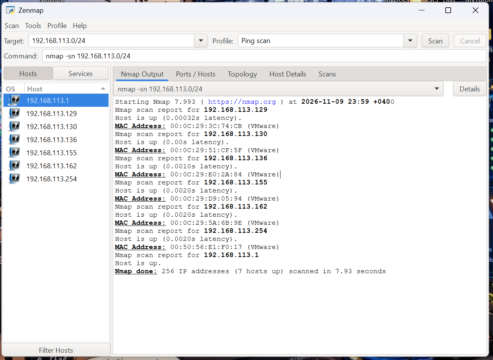
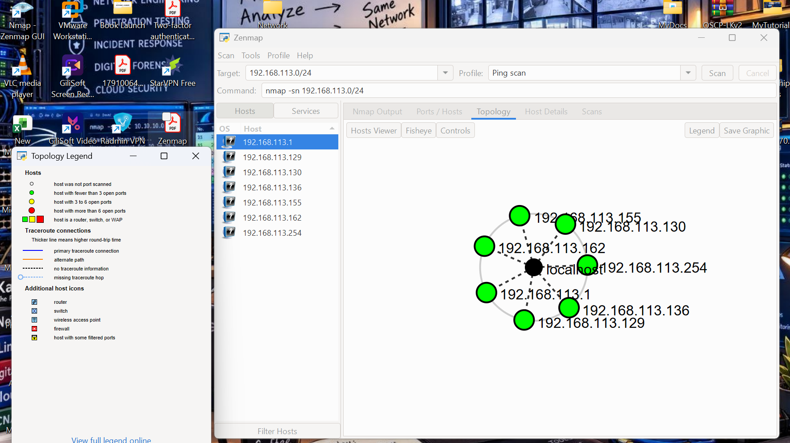

# PENETRATION-TESTING-REPORT

## 🔍 FOOTPRINTING &amp; NETWORK SCANNING PHASES

## Liability Disclaimer
I have performed these activities only on the systems & devices where I had secured written permission or the devices/systems that I own myself. All these materials are for education and research purpose only. Do not use anything from here to break the law. The instructor, the authors and Networkwalks are not responsible for what you do with this knowledge. Every action you take is your own responsibility. Misuse can lead to criminal charges, heavy fines, loss of your job and a permanent record. In most countries unauthorized access is a crime even when nothing is damaged.

## Table of Contents
1.	Executive Summary
2.	Assessment Scope and Authorization
3.	Assessment Methodology and Tools
4.	Phase 1 – External Reconnaissance and Footprinting
5.	Phase 2 – Internal Network Discovery
6.	Consolidated Security Findings
7.	Remediation Recommendations
8.	Assessment Limitations
9.	Conclusion
10.	Assessor Declaration 

## 1. EXECUTIVE SUMMARY
This report documents the results of an authorized cybersecurity assessment conducted as part of the Networkwalks cybersecurity training programme.

The assessment focused on two foundational penetration testing phases:
•	Phase 1: Reconnaissance and Footprinting.
•	Phase 2: Scanning and Network Discovery.
The assessment involved an external reconnaissance exercise against Networkwalks.com and an internal network discovery exercise within a VMware virtual laboratory.
The primary objective was to identify publicly observable website infrastructure, technologies, DNS configuration, security controls and active devices within the authorized internal network.

## 1.1 External Assessment Summary
The external assessment identified the following technologies and infrastructure characteristics:

•	Domain registration through GoDaddy.

•	Hosting infrastructure associated with HostGator.

•	Apache web server identification.

•	WordPress content management system.

•	WordPress Download Manager plugin identification.

•	ModSecurity (SpiderLabs) web application firewall detection.

•	Public IPv4 address: 192.232.216.135.

•	DNSSEC reported as unsigned.

•	SPF record identified.

•	Further verification required for DKIM and DMARC.

•	Additional HTTP security-header improvements recommended.

No confirmed exploitable vulnerabilities were established from the supplied evidence.

## 1.2 Internal Network Assessment Summary
An internal host discovery assessment was conducted against:

Authorized laboratory network

192.168.113.0/24

The assessment used Nmap 7.993 through the Zenmap graphical interface.

The command executed was: nmap -sn 192.168.113.0/24

The scan identified:

| Metric | Result | 
|------|---------|
| Total IPv4 addresses | 256 | 
| Active hosts identified | 7 | 
| Scan duration | 7.93 seconds |
| MAC addresses displayed | 6 |
| Identified VMware MAC vendors | 6 | 

The results provided an initial overview of the virtual laboratory network.

## 1.3 Overall Assessment
The assessment successfully achieved its objectives for reconnaissance, footprinting and initial network discovery.

However, the activities did not include comprehensive service enumeration, authenticated testing, vulnerability verification or exploitation.

Consequently, the findings should be interpreted as preliminary security observations rather than a complete determination of the security posture of the assessed systems.

## 2. ASSESSMENT SCOPE AND AUTHORIZATION

2.1 Assessment Targets

Two environments were included in the assessment.	

| Target | Assessment type  | 
|------|---------|
| [Total IPv4 addresses](https://networkwalks.com ) | External reconnaissance | 
| 192.168.113.0/24 | Internal network discovery | 
| VMware virtual laboratory | Internal testing environment |

## 2.2 Authorization

The assessment was performed on systems for which written authorization had been obtained or within the assessor's own laboratory environment.

| Authorization item | Status | 
|------|---------|
| Client permission | Confirmed by assessor | 
| Local LAN authorization | Assessor-owned environment | 
| Assessment purpose | Educational and security research |
| Exploitation | Not performed | 
| Authenticated testing | Not performed |

## 2.3 Assessment Objectives

The objectives were to:

1.	Identify publicly available domain registration information.
2.	Identify website technologies and infrastructure.
3.	Detect the presence of a web application firewall.
4.	Review publicly observable DNS configuration.
5.	Inspect selected HTTP response headers.
6.	Identify active devices on the authorized internal network.
7.	Examine available MAC address vendor information.
8.	Visualize the discovered network topology.
9.	Document observations and security improvement opportunities.

## 3. ASSESSMENT METHODOLOGY AND TOOLS

The assessment followed a structured reconnaissance and network discovery methodology.

## 3.1 Tools Used	
	
| Tool | Purpose | 
|------|---------|
| WHOIS | Domain registration investigation | 
| WhatWeb | Website technology fingerprinting | 
| WAFW00F | Web application firewall detection |
| NSLookup | DNS resolution | 
| DNSRecon | DNS record enumeration |
| cURL | HTTP response inspection |
| Nmap 7.993 | Network host discovery |
| Zenmap | Graphical network scanning and topology visualization |
| Kali Linux | Security assessment environment |

## 3.2 Assessment Phases

Phase 1 – Reconnaissance and Footprinting

Completed

Public information gathering, domain research, technology identification and DNS inspection.

Phase 2 – Scanning and Network Discovery

Completed

Internal host discovery, MAC address identification and topology visualization.

Phase 3 – Enumeration

In progress

Phase 4 – Vulnerability Assessment

Pending

Phase 5 – Reporting and Remediation Validation

In progress

## 4. PHASE 1 – EXTERNAL RECONNAISSANCE AND FOOTPRINTING

The external assessment focused on collecting publicly observable information about the target domain, website technologies, hosting infrastructure, DNS records and HTTP security configuration.

No exploitation or authenticated penetration testing was performed.

## 4.1 WHOIS Domain Investigation

Tool: WHOIS

Command executed: whois networkwalks.com

## Results

	

| Parameter | Identified information | 
|------|---------|
| Registrar | GoDaddy.com, LLC | 
| Creation date | 6 November 2019 | 
| Expiration date | 6 November 2027 | 
| Registrant | Registration Private | 
| Privacy provider | Domains By Proxy, LLC | 
| DNSSEC | Unsigned | 

Observation

The domain registration information indicates that the registrant's identity is protected through a domain privacy service.

The supplied WHOIS results also indicate that DNSSEC signing was not enabled at the time of the investigation.
Risk classification: Informational.

Recommendation

•	Maintain accurate domain registration information.

•	Ensure authorized personnel control domain administration.

•	Monitor domain renewal dates.

•	Evaluate DNSSEC deployment.

Evidence: Screenshot 1 – WHOIS results.

## 4.2 Website Technology Identification

Tool: WhatWeb

Command executed: whatweb networkwalks.com

Note: These are technology-fingerprinting results, not independently verified installed software versions. The reported version strings, particularly Bootstrap 7.1.4, should be validated against the actual components before being treated as confirmed versions.

Observation

The website appears to operate using WordPress and includes a download management plugin.

Technology fingerprinting can reveal information about the application's software stack. However, identifying a technology or version does not automatically establish that it is vulnerable.

Risk classification: Requires further validation.

Recommendations

•	Verify WordPress core version and patch status.

•	Review installed plugin and theme versions.

•	Remove unused plugins and themes.

•	Restrict administrative access.

•	Maintain regular backups.

•	Monitor relevant security advisories.

Evidence: Screenshot 2 – WhatWeb results.

## 4.3 Web Application Firewall Detection

Tool: WAFW00F

Command executed: wafw00f networkwalks.com

Observation

The assessment detected ModSecurity, indicating the presence of a web application firewall.

A WAF can provide an additional security layer by inspecting and filtering web requests. However, its presence does not guarantee that the underlying application is secure.

Assessment classification: Positive security control identified.

Recommendations

•	Maintain updated WAF rules.

•	Monitor security logs.

•	Review blocked requests.

•	Periodically assess rule effectiveness.

•	Verify that legitimate application traffic is not unnecessarily blocked.

Evidence: Screenshot 3 – WAFW00F results.

## 4.4 DNS Resolution

Tool: NSLookup

Command executed: nslookup networkwalks.com

Observation

The domain successfully resolved to the identified public IPv4 address.

The DNS server displayed in the results was the local resolver at 192.168.1.1.

Risk classification: Informational.

Recommendations

•	Monitor DNS availability.

•	Maintain accurate DNS records.

•	Review DNS provider security.

•	Ensure that only authorized administrators can modify DNS records.

Evidence: Screenshot 4 – NSLookup results.

## 4.5 DNS Enumeration

Command executed: dnsrecon -d networkwalks.com

## SPF Record

The supplied assessment identified the following SPF string:

text

v=spf1 +a +mx +ip4:50.87.144.87 +include: websitewelcome.com ~all

Observation

The results indicate that the domain uses HostGator-associated nameservers and has an SPF record.

DNSSEC was reported as unsigned.

DKIM and DMARC were not verified during the documented assessment.

The supplied SPF string should also be checked against the authoritative DNS TXT record because its displayed include: syntax appears incomplete or malformed.

Risk classification: Low – configuration review recommended.

Recommendations

1.	Evaluate DNSSEC deployment.

2.	Verify the SPF record syntax and authorized sending infrastructure.

3.	Configure DKIM signing where applicable.

4.	Implement an appropriate DMARC policy.

5.	Review DNS delegation consistency.

6.	Monitor email authentication reports.

Evidence: Screenshot 5 – DNSRecon results.

## 4.6 HTTP Response Header Analysis

Tool: cURL

Command executed: curl -I https://networkwalks.com

Other observed information included:

•	X-Endurance-Cache-Level: 0

•	X-Nginx-Cache: WordPress

•	WordPress REST API references.

## A. Security Header Assessment

The supplied response included Permissions-Policy and Referrer-Policy.

The following headers were not observed in the supplied response:

•	Strict-Transport-Security (HSTS).

•	Content-Security-Policy (CSP).

•	X-Content-Type-Options.

## Potential impact

Depending on application behavior and browser configuration, missing security headers may reduce protection against certain browser-side attacks.

Risk classification: Informational – further validation required.

Recommendations

•	Evaluate HSTS implementation.

•	Develop an appropriate Content Security Policy.

•	Configure X-Content-Type-Options: nosniff.

•	Review frame protection through CSP or X-Frame-Options.

•	Validate headers across multiple relevant application responses.

## B. Cookie Security Assessment

The supplied response identified the cookie:

text

wpdm_client

Observed attributes:

•	Secure.

•	HttpOnly.

The SameSite attribute was not observed in the supplied evidence.

Observation

Secure and HttpOnly are useful cookie security attributes. The SameSite configuration should be reviewed.

## Risk classification: Informational.

Recommendation

Evaluate an appropriate SameSite policy while ensuring that legitimate website functionality is maintained.

## C. WordPress REST API Exposure

The response referenced:

text

https://networkwalks.com/wp-json/

It also referenced:

text

https://networkwalks.com/wp-json/wp/v2/pages/53

Observation

The WordPress REST API is publicly advertised.

Public availability of a WordPress REST API endpoint is not, by itself, a security vulnerability. Public endpoints may 

legitimately expose published website information.

## Potential impact

Improperly configured API permissions could expose information that should not be publicly accessible.

Recommendations

•	Review publicly accessible API endpoints.

•	Verify access permissions.

•	Ensure sensitive information is not exposed.

•	Review API authentication and authorization controls.

Risk classification: Informational.

## D. Additional HTTP Information

The response also contained:

•	X-Endurance-Cache-Level: 0.

•	X-Nginx-Cache: WordPress.

•	Server: Apache.

These headers provide information about the hosting and caching environment.

No confirmed security vulnerability was established from these headers.

Evidence: Screenshot 6 – cURL HTTP response headers.

## 4.7 External Assessment Findings

The external reconnaissance exercise identified several security configuration areas that warrant further review.	
	
| ID | Finding | Classification |
|------|---------|----------|
| EXT-01 | DNSSEC reported unsigned | Low |
| EXT-02 | Domain registrant privacy protection | Informational |
| EXT-03 | WordPress and plugin versions require verification | To be validated |
| EXT-04 | DKIM and DMARC not verified | To be validated |
| EXT-05 | HTTP security headers require further review | To be validated |
| EXT-06 | ModSecurity WAF detected | Positive control |
| EXT-07 | WordPress REST API publicly advertised | Informational |

## 5. PHASE 2 – INTERNAL NETWORK DISCOVERY

Assessment type: Internal network discovery and host identification.

Assessment date: 9 November 2026.

Environment: VMware Virtual Lab.

Tool: Nmap 7.993 / Zenmap.

## 5.1 Assessment Overview

An internal network discovery assessment was conducted against the following subnet:

text

192.168.113.0/24

The primary objective was to identify active hosts within the authorized laboratory network and obtain an initial understanding of the network environment.

## 5.2 Target Network Information

| Parameter | Value |
|------|---------|
| Target network | 192.168.113.0/24 |
| Network address | 192.168.113.0 |
| Broadcast address | 192.168.113.255 |
| Subnet mask | 255.255.255.0 |
| Total IPv4 addresses | 256 |
| Assessment type | Host discovery |
| Tool | Nmap 7.993 |
| Interface | Zenmap GUI |

## 5.3 Host Discovery Methodology

The assessment used Nmap host discovery.

Command executed: nmap -sn 192.168.113.0/24

The -sn option instructs Nmap to perform host discovery without conducting a port scan.

The purpose was to identify responding devices within the specified subnet.

The assessment also collected MAC address information where available.

## 5.4 Active Hosts Identified

The scan identified seven active IP addresses.

| No. | IP address | Status | MAC address |
|------|---------|---------|--------|
| 1 | 192.168.113.1 | Up | Not displayed |
| 2 | 192.168.113.129 | Up | 00:0C:29:3C:74:CB |
| 3 | 192.168.113.130 | Up | 00:0C:29:51:CF:5F |
| 4 | 192.168.113.136 | Up | 00:0C:29:E0:2A:84 |
| 5 | 192.168.113.155 | Up | 00:0C:29:D9:05:94 |
| 6 | 192.168.113.162 | Up | 00:0C:29:5A:6B:9E |
| 7 | 192.168.113.254 | Up | 00:50:56:E1:F0:17 |

Observation

Seven hosts responded to the discovery scan.

Six hosts had MAC addresses displayed in the captured Nmap output.

The MAC vendor information identified all six displayed addresses as VMware-associated devices.

The address 192.168.113.1 was also identified as active, although its MAC address was not displayed in the supplied output.

The results suggest that the laboratory contains multiple virtualized devices.

## 5.5 Scan Statistics
	
| Metric | Result |
|------|---------|
| Total addresses in subnet | 256 |
| Active hosts identified | 7 |
| MAC addresses displayed | 6 |
| VMware-associated MAC addresses | 6 |
| Scan duration | Approximately 7.93 seconds |
| Nmap version | 7.993 |
| Scan type | Ping scan |

The remaining 249 addresses were not identified as responding hosts during this particular scan. This does not independently prove that all those addresses are unused.

## 5.6 Network Topology Analysis

The Zenmap Topology feature was used to visualize the discovered hosts and their relationship to the local scanning machine.

The topology displayed the following addresses:

•	192.168.113.1

•	192.168.113.129

•	192.168.113.130

•	192.168.113.136

•	192.168.113.155

•	192.168.113.162

•	192.168.113.254

Observation

The visualization provided an initial graphical overview of the discovered laboratory devices.

The topology should not be interpreted as definitive evidence of the physical network layout, routing relationships or open ports. Those details require separate verification.

Evidence: Screenshot 8 – Zenmap network topology.

## 5.7 Internal Network Security Findings

Finding INT-01: Multiple Active Devices Identified

Severity: Informational.

Description

Seven active hosts were identified within the target subnet.

Security implication

Active devices represent network assets that should be documented and managed.

Unknown or unauthorized devices may introduce security risks if they are not properly monitored.

Recommendations

•	Maintain an updated network asset inventory.

•	Verify that discovered devices are authorized.

•	Monitor network connectivity.

•	Investigate unexpected devices.

Finding INT-02: VMware-Associated Devices Identified

Severity: Informational.

Description

Six discovered devices returned MAC addresses identified as VMware-associated.

Security implication

The results suggest the presence of multiple virtualized systems within the laboratory.

Virtual machines should be configured with appropriate security controls and network segmentation.

Recommendations

•	Review virtual machine network configurations.

•	Apply appropriate network segmentation.

•	Maintain supported operating systems.

•	Restrict unnecessary communication between virtual machines.

Finding INT-03: Limited Service-Level Visibility

Severity: Observation.

Description

The assessment used the -sn option, which performs host discovery without conducting TCP or UDP port scanning.

Therefore, the assessment did not establish which network services were running on the discovered devices.

Recommendations

•	Conduct an authorized follow-up service assessment.

•	Review exposed services.

•	Identify unnecessary services.

•	Evaluate firewall configurations.

•	Document confirmed service information.

## 5.8 Internal Assessment Conclusion

The internal network discovery assessment successfully identified seven active hosts within the authorized VMware laboratory subnet.

The assessment achieved its primary objective of identifying active devices and producing an initial network topology visualization.

However, service exposure, operating system details and vulnerabilities remain undetermined.

Further authorized assessment is required to establish the security posture of individual devices.

## 6. CONSOLIDATED SECURITY FINDINGS

The following table consolidates the observations from both assessment environments.

| Finding ID | Description | Classification |
|------|---------|---------|
| EXT-01 | DNSSEC reported unsigned | Low |
| EXT-02 | Domain registration privacy protection | Informational |
| EXT-03 | WordPress and plugin maintenance requires verification | To be validated |
| EXT-04 | DKIM and DMARC not verified | To be validated |
| EXT-05 | HTTP security headers require further review | To be validated |
| EXT-06 | ModSecurity WAF detected | Positive control |
| EXT-07 | WordPress REST API publicly advertised | Informational |
| INT-01 | Seven active internal hosts identified | Informational |
| INT-02 | Six VMware-associated MAC addresses identified | Informational |
| INT-03 | Service-level visibility remains limited | Observation |

## 6.1 Overall Risk Assessment

Based on the evidence supplied:

•	No critical vulnerabilities were confirmed.

•	No high-severity vulnerabilities were confirmed.

•	No medium-severity vulnerabilities were confirmed.

•	Several low-risk configuration improvements were identified.

•	Additional testing is required before a comprehensive security conclusion can be made.

Important: These classifications represent preliminary observations, not a complete vulnerability assessment.

## 7. REMEDIATION RECOMMENDATIONS

The following recommendations are intended to improve the security posture of the assessed environments.

### Priority 1 – Application Security

•	Verify WordPress core version and patch status.

•	Review installed plugins and themes.

•	Remove unused components.

•	Enforce strong administrator passwords.

•	Enable multi-factor authentication where supported.

•	Review WordPress administrative permissions.

•	Maintain regular application backups.

### Priority 2 – Infrastructure Security

•	Evaluate DNSSEC implementation.

•	Review DNS records and delegation.

•	Verify HTTPS configuration.

•	Review HTTP security headers.

•	Monitor ModSecurity security logs.

•	Maintain accurate network asset inventories.

•	Review virtual machine network segmentation.

### Priority 3 – Email Security

•	Verify SPF configuration.

•	Configure DKIM.

•	Implement an appropriate DMARC policy.

•	Review authorized email-sending infrastructure.

•	Monitor email authentication reports.

### Priority 4 – Continuous Monitoring

•	Perform regular authorized vulnerability assessments.

•	Maintain application and system backups.

•	Review access logs.

•	Monitor security advisories.

•	Investigate unexpected network devices.

•	Conduct periodic security reviews.

## 8. ASSESSMENT LIMITATIONS

The following limitations apply to this assessment.

## 8.1 External Assessment Limitations

1.	The external assessment was limited to passive reconnaissance and basic configuration inspection.

2.	No authenticated application testing was performed.

3.	No exploitation was attempted.

4.	No comprehensive vulnerability assessment was performed.

5.	Software version information was based on technology fingerprinting.

6.	DNSSEC, DKIM and DMARC configurations require additional validation.

7.	HTTP header observations were based on the supplied response evidence.

## 8.2 Internal Assessment Limitations

1.	Only host discovery was performed.

2.	No TCP or UDP port scanning was conducted.

3.	No service version detection was performed.

4.	No operating system fingerprinting was confirmed.

5.	No vulnerability scanning or exploitation was conducted.

6.	No authentication or access-control testing was performed.

7.	The results represent the observed network state at the time of scanning.

The absence of identified vulnerabilities must not be interpreted as evidence that the assessed systems are completely secure.

## 9. CONCLUSION

The authorized cybersecurity assessment of Networkwalks.com and the internal VMware laboratory successfully completed the foundational activities associated with reconnaissance, footprinting and network discovery.
The external assessment identified the website's publicly observable technologies, hosting associations, DNS configuration and selected HTTP security controls.
The investigation identified Apache, WordPress, a WordPress Download Manager plugin and ModSecurity web application firewall protection.
It also highlighted opportunities for improvement involving DNSSEC, email authentication, software maintenance verification and HTTP security headers.
The internal network assessment successfully identified seven active hosts within the 192.168.113.0/24 subnet using Nmap 7.993 and Zenmap.
Six displayed MAC addresses were identified as VMware-associated, suggesting the presence of multiple virtual machines in the laboratory.
The Zenmap topology visualization provided an initial graphical representation of the discovered network.
Although the assessment achieved its objectives for the first two phases, additional work is required to establish the security posture of the identified systems.
Future assessments should include authorized enumeration, service configuration review, vulnerability verification, access-control testing and remediation validation.

## FINAL ASSESSMENT STATUS

Phases 1 and 2 completed

•	Phase 1: Reconnaissance and Footprinting – Completed.

•	Phase 2: Scanning and Network Discovery – Completed.

•	Phase 3: Enumeration – In progress.

•	Phase 4: Vulnerability Assessment – Pending.

•	Phase 5: Reporting and Remediation Validation – In progress.

Overall conclusion: Preliminary external reconnaissance and internal network discovery successfully completed. Further authorized security testing is recommended.

## 10. ASSESSOR DECLARATION

I, Lovemore Chamboko, confirm that this report documents the activities and observations from the cybersecurity assessment conducted as part of the Networkwalks training programme.

The assessment activities were limited to authorized targets and the assessor's own laboratory environment.

The findings presented in this document are based on the available command outputs, observations and evidence collected during the assessment.

I acknowledge that further validation is required before making definitive conclusions about the security posture of the assessed systems.

### END OF REPORT

NETWORKWALKS CYBERSECURITY PROGRAMME

W2-PM-FINAL | Version 1.0

### Prepared by: Lovemore Chamboko

### CONFIDENTIAL – AUTHORIZED DISTRIBUTION ONLY

